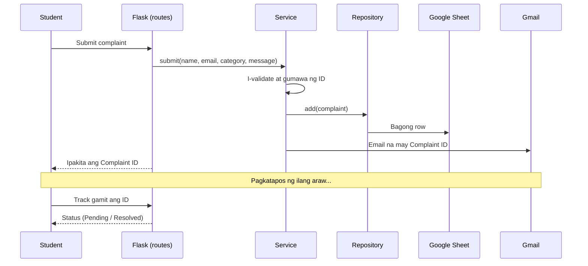

# Student Complaint System

Isang web system kung saan nagsa-submit ang students ng complaint, nakakakuha agad ng **Complaint ID** sa email, at puwedeng i-track kung na-resolve na ito.

**Python (Flask)** ang utak, **HTML** ang mukha, at **Google Sheets** ang database.

## Features

- Student form para mag-submit ng complaint
- Awtomatikong email na may Complaint ID (Gmail)
- Track page: ilalagay lang ang ID para makita ang status
- Admin dashboard na may password, filter, at bilang ng complaints
- Status: `Pending`, `In Progress`, `Resolved`, may remarks ang admin
- Awtomatikong "Resolved" email (isang beses lang, kahit ulit-ulitin)
- DEV_MODE para ma-test ang system nang walang Google at Gmail

## Paano ito gumagana

Isipin ang system bilang isang restaurant:

| Sa restaurant | Sa system | File |
|---|---|---|
| Customer | Student at admin | browser |
| Menu at order form | HTML pages | `templates/` |
| Waiter | Flask routes. Tumatanggap ng order, walang alam sa pagluluto | `app.py` |
| Head chef | Service. Dito ang lahat ng desisyon at rules | `services/complaint_service.py` |
| Order slip | `Complaint` object | `models/complaint.py` |
| Bodega | Repository. Taga-kuha at taga-lagay ng data | `repositories/` |
| Estante sa bodega | Google Sheet | cloud |
| Taga-sulat ng text message | `ComplaintNotifier` | `services/email_service.py` |
| Rider | `SmtpEmailSender` (Gmail) | `services/email_service.py` |

Ang waiter ay hindi nagluluto at ang chef ay hindi pumupunta sa estante. Bawat isa ay may iisang trabaho lang.

### Ang paglalakbay ng isang complaint



1. Nag-type ang student ng complaint at pinindot ang Submit. Ipinapadala ng browser ang data sa `/api/complaints`.
2. Tinanggap ito ng Flask at ipinasa sa service.
3. Sinusuri ng service ang pangalan, email, category, at haba ng complaint. Kapag may mali, ibabalik agad ito.
4. Gumagawa ng ID tulad ng `CMP-2026-0001-WZ91`. Ang `0001` ay ang bilang at ang `WZ91` ay random, para hindi mahulaan ng ibang student.
5. Naglalagay ang repository ng bagong row sa Google Sheet.
6. Gumagawa ang notifier ng email at ipinapadala ito ng Gmail sa student.
7. Ipinapakita sa screen ang ID.
8. Kapag pinindot ng admin ang **Resolved** sa `/admin`, mag-uupdate ang Sheet at may pangalawang email na ipapadala.
9. Sa Track page, ilalagay ng student ang ID at makikita niyang Resolved na.

## Project structure

```
complaint_system/
├── app.py                         Flask routes lang
├── config.py                      Settings mula sa .env
├── models/
│   └── complaint.py               Complaint class at Status enum
├── repositories/
│   ├── base.py                    Abstract ComplaintRepository
│   ├── sheets_repository.py       Google Sheets (gspread)
│   └── memory_repository.py       In-memory, para sa test at DEV_MODE
├── services/
│   ├── complaint_service.py       Business logic
│   └── email_service.py           EmailSender, SmtpEmailSender, ComplaintNotifier
├── templates/                     HTML (Jinja2)
├── static/style.css
├── tests/                         12 unit tests
├── requirements.txt
└── .env.example
```

## OOP at OOD: bakit ganito ang pagkakagawa

| Prinsipyo | Saan makikita |
|---|---|
| **Encapsulation** | May mga private na attribute ang `Complaint` (`_status`, `_remarks`). Dumadaan ang pagpalit ng status sa `change_status()`, na nagse-set din ng oras ng resolve |
| **Abstraction** | Ang `ComplaintRepository` at `EmailSender` ay mga abstract class na nagsasabi kung *ano* ang dapat magawa, hindi kung *paano* |
| **Polymorphism** | Dalawang repository (Google Sheets at memory) ang sumusunod sa iisang kontrata, kaya napapalitan ang isa ng isa |
| **Dependency Injection** | Hindi gumagawa ng sariling database ang service. Binibigyan ito ng repository at notifier sa `build_service()` |
| **Single Responsibility** | Isang trabaho lang bawat class. Ang `ComplaintNotifier` ay para sa laman ng email, ang `SmtpEmailSender` ay para sa pagpapadala |
| **Open/Closed** | Gusto mong lumipat sa MySQL? Gumawa ng isang bagong repository class. Hindi mo gagalawin ang service, routes, o HTML |

Dahil sa disenyo, na-test ang buong logic nang walang Google at Gmail.

## Mga desisyon sa disenyo

- **Hindi nawawala ang complaint kapag pumalya ang email.** Una itong sine-save, saka sinusubukan ang email. Kapag nag-fail, ipinapakita pa rin ang ID sa screen.
- **Isang beses lang ang Resolved email.** Hindi ito magdodoble kahit ilang beses pindutin ang Resolved.
- **May lock sa paggawa ng ID**, para hindi magka-parehong numero kapag sabay ang submit.
- **Ligtas ang Track page.** Status, category, petsa, at remarks lang ang ipinapakita, walang email at walang mismong reklamo.
- **Naka-escape ang lahat ng text sa HTML**, kaya hindi puwedeng mag-inject ng script.

## Setup

### 1. I-install

```bash
pip install -r requirements.txt
cp .env.example .env     # sa Windows: copy .env.example .env
```

### 2. Subukan muna nang walang Google (DEV_MODE)

Itakda ang `DEV_MODE=true` sa `.env`, tapos:

```bash
python app.py
```

Buksan ang http://127.0.0.1:5000. Ang mga email ay ipi-print sa terminal, at in-memory lang ang database (mawawala ang data kapag nag-restart). Ang admin ay nasa `/admin` at ang password ay ang `ADMIN_PASSWORD` sa `.env`.

### 3. I-connect ang Google Sheets

1. Pumunta sa https://console.cloud.google.com at gumawa ng project.
2. Sa APIs & Services, Library, i-**Enable** ang **Google Sheets API** at **Google Drive API**.
3. Sa IAM & Admin, Service Accounts, gumawa ng service account.
4. Sa Keys, Add key, Create new key, piliin ang **JSON**. I-rename ang file bilang `credentials.json` at ilagay sa tabi ng `app.py`.
5. Gumawa ng bagong Google Sheet at kopyahin ang ID sa URL (`.../d/<ID>/edit`) papunta sa `GOOGLE_SHEET_ID`.
6. I-**Share** ang Sheet sa `client_email` na nasa `credentials.json`, bilang **Editor**.

Awtomatikong ginagawa ng app ang tab na `Complaints` at ang headers sa Row 1. Huwag baguhin ang order ng columns.

### 4. I-connect ang Gmail

1. I-on ang 2-Step Verification: https://myaccount.google.com/security
2. Gumawa ng App Password: https://myaccount.google.com/apppasswords
3. Ilagay sa `.env` (walang space sa password):

```dotenv
GMAIL_USER=youremail@gmail.com
GMAIL_APP_PASSWORD=abcdefghijklmnop
```

### 5. Patakbuhin

Itakda ang `DEV_MODE=false` at i-restart ang app:

```bash
python app.py
```

## Environment variables

| Variable | Gamit |
|---|---|
| `SECRET_KEY` | Pang-secure ng admin session. Palitan ng mahabang random text |
| `ADMIN_PASSWORD` | Password ng `/admin`. Palitan ito |
| `GOOGLE_SHEET_ID` | ID ng Google Sheet |
| `GOOGLE_WORKSHEET` | Pangalan ng tab (default: `Complaints`) |
| `GOOGLE_CREDENTIALS_FILE` | Path ng JSON key (default: `credentials.json`) |
| `GMAIL_USER` | Gmail na magpapadala |
| `GMAIL_APP_PASSWORD` | 16-character App Password |
| `DEV_MODE` | `true` para sa in-memory DB at console email |

## Tests

```bash
python -m unittest discover -s tests -t .
```

Sakop ng tests ang validation, pagbuo ng ID, email sa submit at resolve, ang "isang beses lang" na rule, ang pagpigil sa pagtagas ng private data sa Track page, at ang buong flow ng Flask routes.

## Troubleshooting

| Problema | Ayos |
|---|---|
| Walang email at nakikita lang sa terminal | Naka-`DEV_MODE=true` pa. Gawing `false` at i-restart |
| `FileNotFoundError: credentials.json` | Ilagay ang file sa tabi ng `app.py`. Tingnan kung hindi `credentials.json.json` ang pangalan |
| `SpreadsheetNotFound` | Mali ang `GOOGLE_SHEET_ID` |
| `403 PERMISSION_DENIED` | I-share ang Sheet sa `client_email` bilang Editor |
| `403 ... API has not been used` | I-enable ang Google Sheets API sa tamang project |
| `SMTPAuthenticationError 535` | Gamitin ang App Password, hindi ang normal na password |
| `Connection unexpectedly closed` | Subukan ulit. Kung paulit-ulit, i-check ang antivirus o network, o gumamit ng port 465 (`smtplib.SMTP_SSL`) |
| Walang nagbago pagkatapos mag-edit ng `.env` | I-restart ang `python app.py` |

## Seguridad

- **Huwag i-commit ang `.env` at `credentials.json`.** Nasa `.gitignore` na ang dalawa.
- Kapag hindi sinasadyang na-push ang secrets, burahin at gumawa ng bagong service account key at Gmail App Password. Hindi sapat na burahin ang file dahil nasa git history pa ito.
- Palitan ang `SECRET_KEY` at `ADMIN_PASSWORD` bago i-deploy.
- Itakda ang `debug=False` sa dulo ng `app.py` at gumamit ng production server (`gunicorn` o `waitress`) sa deployment.

## Mga limitasyon

- Swak ang Google Sheets sa school project at daan-daang complaints. Kapag libo-libo na, mas bagay ang MySQL o PostgreSQL. Isang bagong repository class lang ang kailangan.
- Isa lang ang admin password, at walang login ang students.
- May limit ang Gmail na mga 500 na email kada araw.
- Kailangang i-host online para magamit ng ibang tao.

## Mga posibleng pagpapabuti

- Hiwa-hiwalay na admin accounts at student login
- Mga attachment (larawan o dokumento) sa complaint
- Email para sa "In Progress" at reminder para sa mga lumang Pending
- Paglipat sa MySQL o PostgreSQL
- Deployment sa Render o PythonAnywhere na may HTTPS

## Tech stack

Python 3 · Flask · Jinja2 · gspread · Google Sheets API · Gmail SMTP · HTML/CSS/JavaScript
